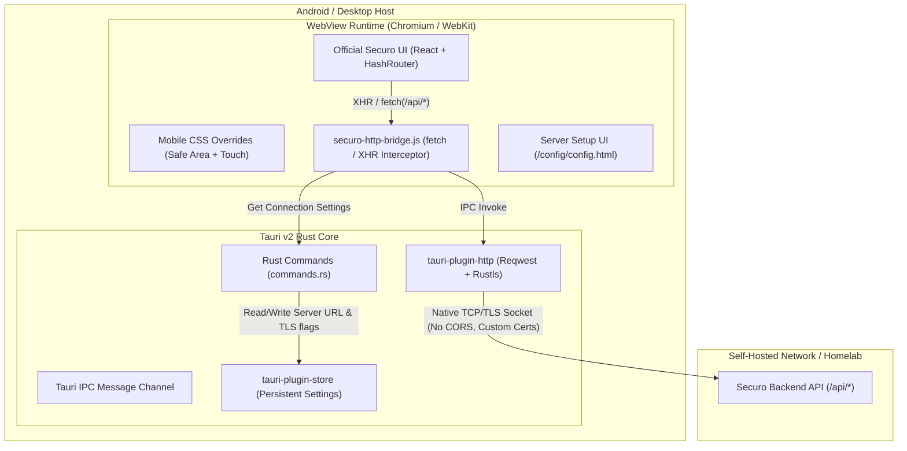
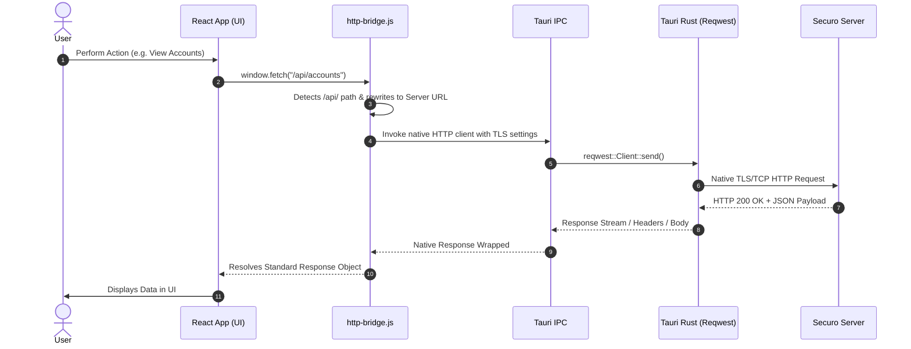
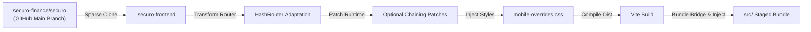

# Securo Native Client Architecture

This document provides a comprehensive technical overview of the architecture, design decisions, and data flows within the **Securo Native Client** (`securo-mobile`).

---

## 1. Design Goals & Philosophy

Securo is a modern, self-hosted personal finance platform. The primary goal of `securo-mobile` is to deliver an authentic, responsive native mobile client on top of Tauri v2 without requiring a completely separate mobile frontend codebase.

### Core Objectives:
1. **Zero Intermediate Infrastructure:** Direct, encrypted communication between the client device and the user's self-hosted server.
2. **Homelab First:** First-class support for self-signed TLS certificates, LAN IP addresses, and private VPN hostnames (Tailscale, WireGuard).
3. **Bypass WebView Network Restrictions:** Overcome mobile browser sandbox limitations (CORS, mixed content, certificate pinning) via a native Rust networking layer.
4. **Automated Frontend Synchronization:** A repeatable pipeline that ingests, patches, and bundles the official Securo web frontend without manual code divergence.
5. **Native Look & Feel:** Edge-to-edge system insets, smooth navigation, and hardware-accelerated rendering.

---

## 2. High-Level System Architecture



---

## 3. The Native HTTP Bridge

### The Problem: Mobile WebView Sandbox Limitations
When running single-page applications (SPAs) inside Android WebViews:
- **CORS Enforcements:** WebViews treat requests from local origins (`tauri://localhost` or `http://localhost`) to remote server endpoints as cross-origin requests. If the remote reverse proxy or server lacks explicit CORS headers, the WebView blocks the request.
- **TLS & Certificate Rejection:** Android's internal WebView strictly prohibits network traffic to servers using self-signed SSL/TLS certificates or internal enterprise root CAs.
- **Mixed Content Policies:** WebViews block plain HTTP traffic if the initial asset loader resolves over HTTPS.

### The Solution: Transparent Native Interception
Instead of running requests through the WebView's browser engine, `src-tauri/bridge/http-bridge.js` monkey-patches the global `window.fetch` and `window.XMLHttpRequest` APIs:



### Key Capabilities of the Bridge:
- **Universal API Interception:** Automatically intercepts `/api/*`, relative URLs, and explicit matches to the configured server host.
- **Custom Certificate Handling:** If `allow_invalid_certs` is enabled, flags `danger.acceptInvalidCerts: true` and `danger.acceptInvalidHostnames: true` are applied directly to the native socket.
- **Binary & Form Data Handling:** Handles standard JSON, `multipart/form-data`, Blobs, `ArrayBuffer`, and URL-encoded payloads seamlessly.
- **Zero React Code Changes:** The frontend application remains completely agnostic of the bridge; it continues invoking standard `fetch()` or `axios`.

---

## 4. Frontend Ingestion & Adaptation Pipeline

The frontend pipeline enables `securo-mobile` to stay continuously up-to-date with upstream changes from `securo-finance/securo`.



### 1. `prepare-frontend.mjs`
- Performs a sparse clone (`--filter=blob:none --sparse`) of the official Securo repository, pulling only the `frontend/` directory to save bandwidth and disk space.
- Replaces `BrowserRouter` with `HashRouter` inside `App.tsx`.
  > *Why HashRouter?* Mobile WebViews load local assets via relative file protocols or virtual origins (`http://tauri.localhost`). Using HTML5 history API navigation results in 404 errors when deep-linking or refreshing the view. Hash routing (`/#/accounts`) guarantees route persistence.
- Adjusts Vite configuration (`base: "./"`) so all compiled JS/CSS script tags resolve relative to the WebView asset root.
- Scans and patches runtime optional chaining (`.find(...)` -> `?.find(...)`) on transient financial state arrays to eliminate undefined reference errors during initial state hydration.

### 2. `stage-frontend.mjs`
- Archives the local fallback configuration screen (`src/config/`).
- Populates `src/` with the compiled Vite production bundle.
- Uses `esbuild` to compile `src-tauri/bridge/http-bridge.js` into an optimized single-file IIFE bundle (`securo-http-bridge.js`).
- Injects a resilient JavaScript error boundary, safe-area viewport configurations (`viewport-fit=cover`), and the bridge script into the HTML header.

---

## 5. Android OS Native Integration

### Edge-to-Edge Window & Safe Area Management (`MainActivity.kt` & `mobile-overrides.css`)
Modern Android devices feature edge-to-edge screens with camera punch-holes, curved corners, and dynamic gesture navigation bars.

`MainActivity.kt` initializes the native activity with edge-to-edge rendering enabled:
```kotlin
package com.securo.mobile

import android.os.Bundle
import androidx.activity.enableEdgeToEdge

class MainActivity : TauriActivity() {
  override fun onCreate(savedInstanceState: Bundle?) {
    enableEdgeToEdge()
    super.onCreate(savedInstanceState)
  }
}
```
Rather than applying native padding on Android's root view (which creates unstyled letterboxing and breaks viewport coordinates), edge-to-edge rendering allows the WebView to span the entire display. The web layout then respects device cutouts and system bars dynamically through standard CSS safe-area insets (`env(safe-area-inset-top)`, `env(safe-area-inset-bottom)`) defined in `mobile-overrides.css`.

### Network Permissions (`AndroidManifest.xml`)
The client dynamically ensures:
- `android.permission.INTERNET`: Required for socket communication.
- `android.permission.ACCESS_NETWORK_STATE`: Injected by `configure-android.mjs` to monitor network reachability across Wi-Fi, cellular, and VPN interfaces.

---

## 6. Server Health Probing & Normalization

When connecting to an instance in `commands.rs`:

1. **URL Normalization:**
   - Trims whitespace and guarantees a protocol scheme (`https://` default if omitted).
   - Validates that no credentials (username/password) or fragment hashes are present in the URL.
   - Cleans trailing slashes and redundant `/api` suffixes to establish a canonical base URL.

2. **Probe Fallback Matrix:**
   To remain compatible with various reverse proxies, custom routing setups, and API versions, the client tests endpoints in order:
   1. `GET {base_url}/api/health`
   2. `GET {base_url}/api/info`
   3. `GET {base_url}/health`
   4. `GET {base_url}/` (Fallback root status probe)

3. **Persistent Storage:**
   Upon receiving a valid HTTP response, the verified URL and TLS parameters are committed to `config.json` via `tauri-plugin-store`.

---

## 7. Performance & Build Optimizations

- **Cargo Profile Tuning:**
  - Thin LTO (`lto = "thin"`) and 16 codegen units in release mode for optimal runtime binary size.
  - Symbols stripped (`strip = true`) and panic set to abort (`panic = "abort"`).
- **Compilation Caching in CI:**
  - `rust-cache` persists compiled Rust dependencies and target artifacts between runs.
  - Gradle caching via `gradle/actions/setup-gradle@v4` reuses daemon state and dependency jars.
