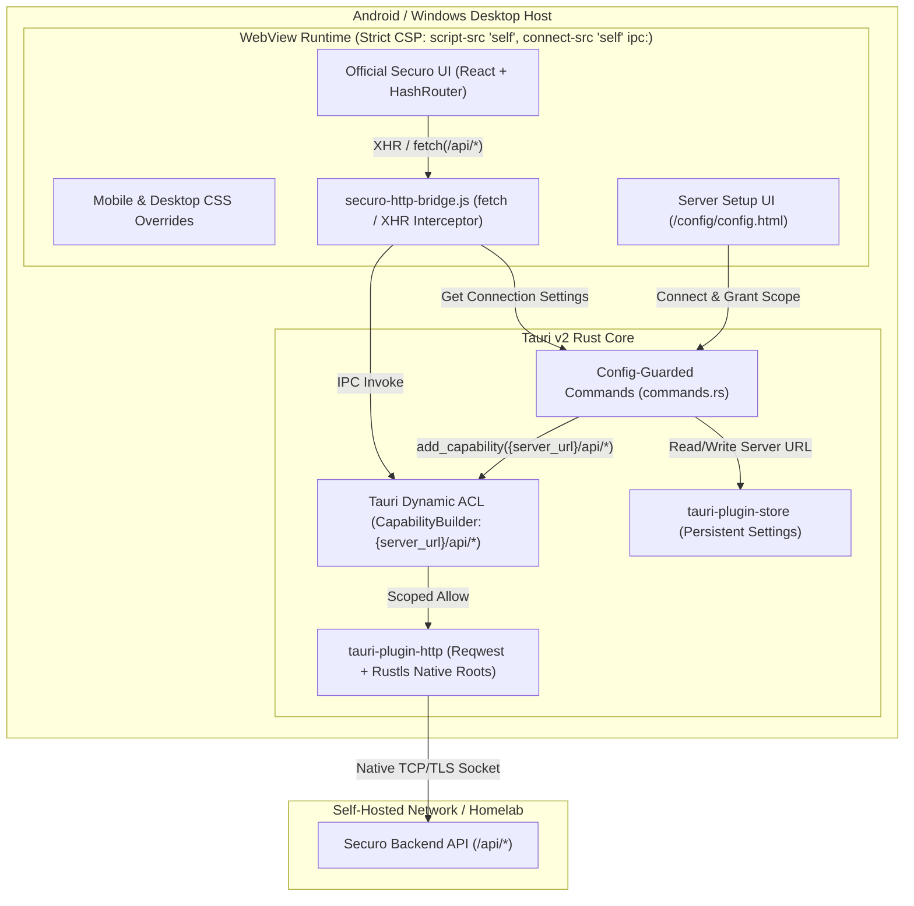
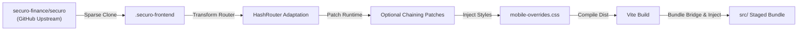

# Securo Client Architecture

This document provides a comprehensive technical overview of the architecture, design decisions, and data flows within **Securo Client** (`securo-client`).

---

## 1. Design Goals & Philosophy

Securo is a modern, self-hosted personal finance platform. The primary goal of `securo-client` is to deliver an authentic, responsive native client on top of Tauri v2 across both desktop (Windows, macOS, Linux) and mobile (Android, iOS) without requiring a completely separate frontend codebase.

### Core Objectives:
1. **Zero Intermediate Infrastructure:** Direct, encrypted communication between the client device and the user's self-hosted server.
2. **Homelab First:** First-class support for OS-trusted private CAs (`mkcert`, Caddy CA, enterprise roots via `rustls-tls-native-roots`), opt-in self-signed TLS certificates, LAN IP addresses, and private VPN hostnames (Tailscale, WireGuard).
3. **Least-Privilege Native Networking:** Overcome browser sandbox limitations (CORS, mixed content) via `@tauri-apps/plugin-http` paired with Tauri v2's runtime `dynamic-acl` (`CapabilityBuilder`) so only `{server_url}/api/*` is ever authorized.
4. **Automated Frontend Synchronization:** A repeatable pipeline that ingests, patches, and bundles the official Securo web frontend without manual code divergence.
5. **Native Look & Feel:** Edge-to-edge system insets on mobile, native window chrome on desktop, and hardware-accelerated rendering.

---

## 2. High-Level System Architecture

---

## 3. The Native HTTP Bridge & Runtime ACL Scoping

### The Problem: Mobile WebView Sandbox vs. Wildcard Capabilities
When running single-page applications (SPAs) inside WebViews:
- **CORS Enforcements:** WebViews treat requests from local origins (`tauri://localhost` or `http://tauri.localhost`) to remote server endpoints as cross-origin requests.
- **Private CAs & Self-Signed TLS:** Internal WebViews often reject homelab root CAs or self-signed certificates.
- **Static Wildcard Risk:** Allowing `http://*` and `https://*` statically in `capabilities/default.json` with `csp: null` would expose arbitrary cross-origin network access if an XSS vulnerability occurred in the frontend.

### The Solution: `@tauri-apps/plugin-http` + Tauri `dynamic-acl` + Strict CSP
1. **Zero Static HTTP Wildcards:** `src-tauri/capabilities/default.json` grants only `core:default`.
2. **Dynamic Per-Server Scope (`CapabilityBuilder`):** On startup (`lib.rs`) and whenever a server is paired (`connect_server` / `save_server_url` in `commands.rs`), Tauri's `CapabilityBuilder` registers `http:default` scoped strictly to `{server_url}/api` and `{server_url}/api/*` on the `main` window.
3. **Configuration Context Guard:** Commands that mutate connection settings (`connect_server`, `save_server_url`, `clear_server_url`, `set_auto_connect`) verify that the caller WebView is on `/config/config.html`, preventing code inside `app.html` from repointing `server_url` to an external host.
4. **Native OS Root Certificates:** `tauri-plugin-http` and `reqwest` enable `rustls-tls-native-roots`, automatically trusting private CAs installed in the OS trust store without needing `allow_invalid_certs`.
5. **Strict CSP (`tauri.conf.json`):** Enforces `default-src 'self'; script-src 'self'; connect-src 'self' ipc: http://ipc.localhost; object-src 'none'`, blocking inline script injection, `eval`, and direct browser exfiltration.

---

## 4. Frontend Ingestion & Adaptation Pipeline

The frontend pipeline enables `securo-client` to stay continuously up-to-date with upstream changes from `securo-finance/securo`.

### 1. `prepare-frontend.mjs`
- Performs a sparse clone (`--filter=blob:none --sparse`) of the official Securo repository (supporting optional ref pinning via `SECURO_REF`), pulling only the `frontend/` directory to save bandwidth and disk space.
- Replaces `BrowserRouter` with `HashRouter` inside `App.tsx`.
- Adjusts Vite configuration (`base: "./"`) so all compiled JS/CSS script tags resolve relative to the WebView asset root.
- Scans and patches runtime optional chaining (`.find(...)` -> `?.find(...)`) on transient financial state arrays.

### 2. `stage-frontend.mjs`
- Archives the local fallback configuration screen (`src/config/`).
- Populates `src/` with the compiled Vite production bundle.
- Copies `bootstrap.html` and external `bootstrap.js` (keeping all HTML entrypoints free of inline scripts for `script-src 'self'` CSP compliance).
- Uses `esbuild` to compile `src-tauri/bridge/http-bridge.js` (including the DOM error boundary) into `securo-http-bridge.js`.
- Injects `viewport-fit=cover`, `mobile-overrides.css`, and `securo-http-bridge.js` into `app.html`.

---

## 5. OS Native Integrations

### Android Edge-to-Edge & Safe Area Management
Edge-to-edge rendering allows the WebView to span the entire display while respecting device cutouts dynamically through standard CSS safe-area insets (`env(safe-area-inset-top)`, `env(safe-area-inset-bottom)`) defined in `mobile-overrides.css`.

### Windows Native Runtime & Window Management
On Windows, Tauri utilizes the evergreen Microsoft Edge WebView2 runtime. In `lib.rs`, if a `server_url` exists and `auto_connect` is enabled, the main dashboard window (`main`) is presented immediately; otherwise, the `config` window guides the user through initial instance pairing.

---

## 6. Server Health Probing & Normalization

When connecting to an instance in `commands.rs`:

1. **URL Normalization:**
   - Trims whitespace and defaults to `https://` if omitted.
   - Rejects embedded credentials (username/password) or URL fragments.
   - Strips trailing slashes and redundant `/api` suffixes.

2. **Probe Fallback Matrix:**
   1. `GET {base_url}/api/health`
   2. `GET {base_url}/api/info`
   3. `GET {base_url}/health`
   4. `GET {base_url}/` (Fallback root status probe)

3. **Persistent Storage & Scope Activation:**
   Upon receiving a valid HTTP response, the verified URL is granted dynamic HTTP scope (`{base_url}/api/*`) and saved to `config.json` via `tauri-plugin-store`.

---

## 7. Multi-Platform Artifact Packaging (`scripts/package-artifacts.mjs`)

| Platform | Format | Canonical Artifact Name Pattern |
| :--- | :--- | :--- |
| **Windows** | NSIS Setup EXE | `securo-{version}-windows-{arch}-setup.exe` |
| **Windows** | WiX MSI | `securo-{version}-windows-{arch}.msi` |
| **Android** | APK | `securo-{version}-{abi}-{buildType}.apk` |
| **macOS** *(Future)* | DMG | `securo-{version}-macos-{arch}.dmg` |
| **Linux** *(Future)* | DEB / AppImage | `securo-{version}-linux-{arch}.deb` / `.AppImage` |

All outputs are staged in `artifacts/` alongside a consolidated `SHA256SUMS.txt` cryptographic manifest.
