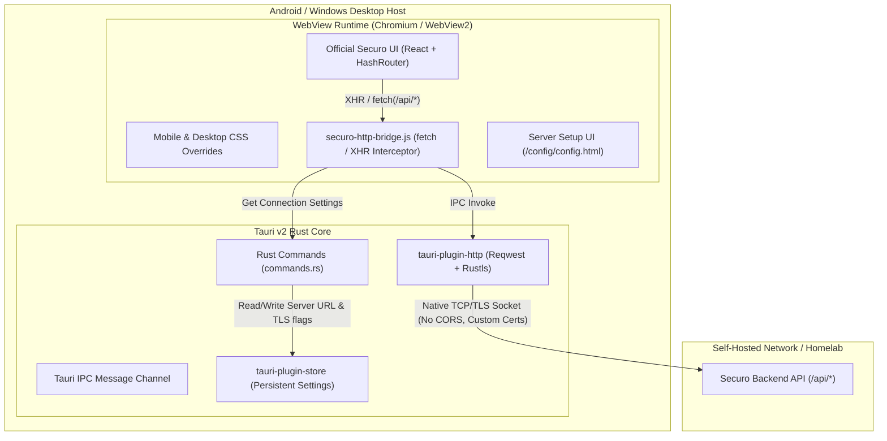
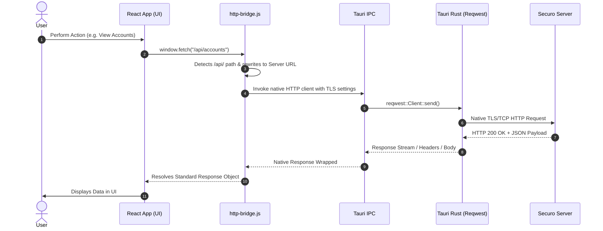
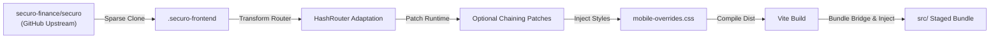
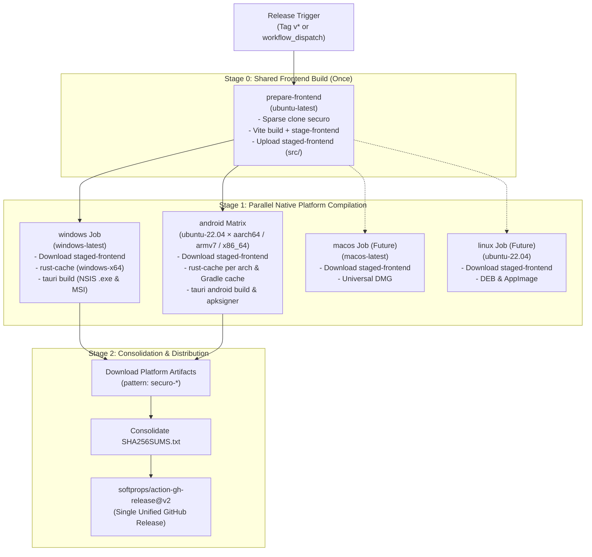

# Securo Native Client Architecture

This document provides a comprehensive technical overview of the architecture, design decisions, and data flows within the **Securo Native Client** (`securo-mobile`).

---

## 1. Design Goals & Philosophy

Securo is a modern, self-hosted personal finance platform. The primary goal of `securo-mobile` is to deliver an authentic, responsive native client on top of Tauri v2 across both desktop (Windows, macOS, Linux) and mobile (Android, iOS) without requiring a completely separate frontend codebase.

### Core Objectives:
1. **Zero Intermediate Infrastructure:** Direct, encrypted communication between the client device and the user's self-hosted server.
2. **Homelab First:** First-class support for self-signed TLS certificates, LAN IP addresses, and private VPN hostnames (Tailscale, WireGuard).
3. **Bypass WebView Network Restrictions:** Overcome mobile and desktop browser sandbox limitations (CORS, mixed content, certificate pinning) via a native Rust networking layer.
4. **Automated Frontend Synchronization:** A repeatable pipeline that ingests, patches, and bundles the official Securo web frontend without manual code divergence.
5. **Native Look & Feel:** Edge-to-edge system insets on mobile, native window chrome on desktop, and hardware-accelerated rendering.

---

## 2. High-Level System Architecture

---

## 3. The Native HTTP Bridge

### The Problem: Mobile WebView Sandbox Limitations
When running single-page applications (SPAs) inside WebViews:
- **CORS Enforcements:** WebViews treat requests from local origins (`tauri://localhost` or `http://localhost`) to remote server endpoints as cross-origin requests. If the remote reverse proxy or server lacks explicit CORS headers, the WebView blocks the request.
- **TLS & Certificate Rejection:** Internal WebViews strictly prohibit network traffic to servers using self-signed SSL/TLS certificates or internal enterprise root CAs.
- **Mixed Content Policies:** WebViews block plain HTTP traffic if the initial asset loader resolves over HTTPS.

### The Solution: Transparent Native Interception
Instead of running requests through the WebView's browser engine, `src-tauri/bridge/http-bridge.js` monkey-patches the global `window.fetch` and `window.XMLHttpRequest` APIs:

### Key Capabilities of the Bridge:
- **Universal API Interception:** Automatically intercepts `/api/*`, relative URLs, and explicit matches to the configured server host.
- **Custom Certificate Handling:** If `allow_invalid_certs` is enabled, flags `danger.acceptInvalidCerts: true` and `danger.acceptInvalidHostnames: true` are applied directly to the native socket.
- **Binary & Form Data Handling:** Handles standard JSON, `multipart/form-data`, Blobs, `ArrayBuffer`, and URL-encoded payloads seamlessly.
- **Zero React Code Changes:** The frontend application remains completely agnostic of the bridge; it continues invoking standard `fetch()` or `axios`.

---

## 4. Frontend Ingestion & Adaptation Pipeline

The frontend pipeline enables `securo-mobile` to stay continuously up-to-date with upstream changes from `securo-finance/securo`.

### 1. `prepare-frontend.mjs`
- Performs a sparse clone (`--filter=blob:none --sparse`) of the official Securo repository (supporting optional ref pinning via `SECURO_REF`), pulling only the `frontend/` directory to save bandwidth and disk space.
- Replaces `BrowserRouter` with `HashRouter` inside `App.tsx`.
  > *Why HashRouter?* Mobile and desktop WebViews load local assets via relative file protocols or virtual origins (`http://tauri.localhost`). Using HTML5 history API navigation results in 404 errors when deep-linking or refreshing the view. Hash routing (`/#/accounts`) guarantees route persistence.
- Adjusts Vite configuration (`base: "./"`) so all compiled JS/CSS script tags resolve relative to the WebView asset root.
- Scans and patches runtime optional chaining (`.find(...)` -> `?.find(...)`) on transient financial state arrays to eliminate undefined reference errors during initial state hydration.

### 2. `stage-frontend.mjs`
- Archives the local fallback configuration screen (`src/config/`).
- Populates `src/` with the compiled Vite production bundle.
- Uses `esbuild` to compile `src-tauri/bridge/http-bridge.js` into an optimized single-file IIFE bundle (`securo-http-bridge.js`).
- Injects a resilient DOM-safe JavaScript error boundary, safe-area viewport configurations (`viewport-fit=cover`), and the bridge script into the HTML header.

---

## 5. OS Native Integrations

### Android Edge-to-Edge & Safe Area Management
Modern Android devices feature edge-to-edge screens with camera punch-holes, curved corners, and dynamic gesture navigation bars. Rather than applying native padding on Android's root view (which creates unstyled letterboxing), edge-to-edge rendering allows the WebView to span the entire display. The web layout then respects device cutouts dynamically through standard CSS safe-area insets (`env(safe-area-inset-top)`, `env(safe-area-inset-bottom)`) defined in `mobile-overrides.css`.

### Windows Native Runtime & Window Management
On Windows, Tauri utilizes the evergreen Microsoft Edge WebView2 runtime. In `lib.rs`, the application checks whether a valid `server_url` and `auto_connect` preference have already been saved in local storage:
- If a server URL exists and `auto_connect` is enabled, the main dashboard window (`main`) is presented immediately.
- Otherwise, the window loads the dedicated server configuration screen (`config`), guiding the user through initial instance pairing before seamlessly switching to the financial dashboard.

---

## 6. Server Health Probing & Normalization

When connecting to an instance in `commands.rs`:

1. **URL Normalization:**
   - Trims whitespace and guarantees a protocol scheme (`https://` default if omitted).
   - Validates that no credentials (username/password) or fragment hashes are present in the URL.
   - Cleans trailing slashes and redundant `/api` suffixes to establish a canonical base URL.

2. **Probe Fallback Matrix:**
   To remain compatible with various reverse proxies, custom routing setups, and API versions, the client tests endpoints in order:
   1. `GET {base_url}/api/health`
   2. `GET {base_url}/api/info`
   3. `GET {base_url}/health`
   4. `GET {base_url}/` (Fallback root status probe)

3. **Persistent Storage:**
   Upon receiving a valid HTTP response, the verified URL and TLS parameters are committed to `config.json` via `tauri-plugin-store`.

---

## 7. Multi-Platform Artifact Packaging (`scripts/package-artifacts.mjs`)

The packaging script automatically discovers and standardizes build outputs across platforms:

| Platform | Format | Canonical Artifact Name Pattern |
| :--- | :--- | :--- |
| **Windows** | NSIS Setup EXE | `securo-{version}-windows-{arch}-setup.exe` |
| **Windows** | WiX MSI | `securo-{version}-windows-{arch}.msi` |
| **Android** | APK | `securo-{version}-{abi}-{buildType}.apk` |
| **macOS** *(Future)* | DMG | `securo-{version}-macos-{arch}.dmg` |
| **Linux** *(Future)* | DEB / AppImage | `securo-{version}-linux-{arch}.deb` / `.AppImage` |

All outputs are staged in `artifacts/` alongside a consolidated `SHA256SUMS.txt` cryptographic manifest.

---

## 8. Release Pipeline Architecture (`.github/workflows/release.yml`)

To avoid redundant network clones and frontend compilations across runners, the release workflow builds and stages the web bundle **once** on Linux (`prepare-frontend`) and distributes the immutable `staged-frontend` artifact to all native platform runners:

