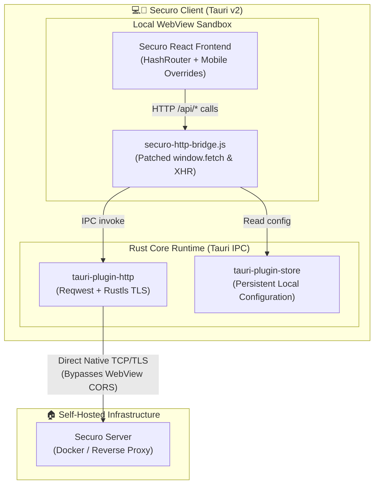

# Securo Client

<div align="center">

[](https://github.com/Marcelo-maga/securo-client/actions/workflows/ci.yml)
[](https://github.com/Marcelo-maga/securo-client/actions/workflows/release.yml)
[](https://tauri.app/)
[](https://www.rust-lang.org/)
[](https://android.com)
[](LICENSE)

**Fast, private native client for self-hosted [Securo](https://github.com/securo-finance/securo) personal finance.**

*Unofficial client built with Tauri v2 and Rust.*

[Download](#installation) •
[Features](#why-securo-client) •
[Architecture](#architecture) •
[Development](#development) •
[Troubleshooting](#troubleshooting) •
[License](#license--attribution)

</div>

---

## Why Securo Client?

Running self-hosted web apps on mobile browsers or PWAs often creates friction: CORS blocks local IP addresses/VPNs, browsers reject self-signed homelab TLS certificates, and browser URL bars waste screen space.

**Securo Client eliminates these issues:**

- ⚡ **Native HTTP Bridge:** Proxies all `fetch` and `XMLHttpRequest` calls through native Rust sockets (`reqwest` + `rustls`), completely bypassing WebView CORS and mixed-content restrictions.
- 🛡️ **Homelab & Self-Signed TLS Support:** Connect securely to private LAN IPs (`192.168.x.x`), Tailscale/WireGuard domains, or servers with self-signed SSL certificates.
- 📱 **True Native Experience:** Edge-to-edge layout, safe-area inset handling (status/navigation bars and camera notches), zero browser chrome, and persistent local session state.
- 🔒 **100% Private & Direct:** Direct peer-to-peer connection to your server. No cloud relays, no tracking, no telemetry.

---

## Installation

### Pre-built Releases (Desktop & Android)

1. Head to the **[Latest Release](https://github.com/Marcelo-maga/securo-client/releases/latest)**.
2. Download the installer for your platform:
   - **Windows Desktop:** `.exe` (NSIS Setup) or `.msi` installer (`x64`)
   - **Android (`arm64-v8a`):** Recommended — modern phones and tablets
   - **Android (`armeabi-v7a`):** Older 32-bit Android devices
   - **Android (`x86_64`):** Android emulators and Chromebooks
3. Install the application on your device.
4. Launch the app, enter your Securo server URL (e.g. `https://securo.homelab.local` or `http://192.168.1.100:8080`), and connect!

---

## Architecture

Securo Client embeds an optimized build of the official Securo web frontend inside a lightweight native shell:



> For deep architectural details, data flow specs, and IPC internals, see [ARCHITECTURE.md](ARCHITECTURE.md).

---

## Development

### Prerequisites

| Tool | Version | Purpose |
| :--- | :--- | :--- |
| **Node.js** | `>= 22.0.0` | Frontend toolchain & scripts |
| **Rust** | Stable (`>= 1.80`) | Compiles the Tauri native shell |
| **Java JDK** | `17` (Temurin) | Android Gradle build |
| **Android SDK/NDK** | API 35 / NDK `27.x` | Android compilation |

### Quick Start

```bash
# 1. Clone & install dependencies
git clone https://github.com/Marcelo-maga/securo-client.git
cd securo-client
npm install

# 2. Fetch, adapt and stage the Securo frontend
npm run frontend:prepare
npm run frontend:stage

# 3. Run on desktop (Linux / macOS / Windows)
npm run tauri -- dev
```

### Building for Android

```bash
# Initialize Android targets (first time only)
rustup target add aarch64-linux-android armv7-linux-androideabi x86_64-linux-android
npm run tauri -- android init
npm run android:configure

# Build debug APK for arm64
npm run tauri -- android build --target aarch64 --debug --apk

# Package & generate SHA-256 checksums in artifacts/
npm run artifacts:package
```

---

## Contributing

Contributions are welcome! Please check out [CONTRIBUTING.md](CONTRIBUTING.md) for branch guidelines, commit conventions, and test commands (`npm test`).

---

## License & Attribution

- **Securo Client** is licensed under the [GNU Affero General Public License v3.0](LICENSE) (AGPL-3.0).
- This project incorporates and adapts frontend components from [Securo](https://github.com/securo-finance/securo), created by Tássio Noronha and licensed under AGPL-3.0.
- This is an independent, community-driven client and is not officially affiliated with or endorsed by the Securo upstream project.
