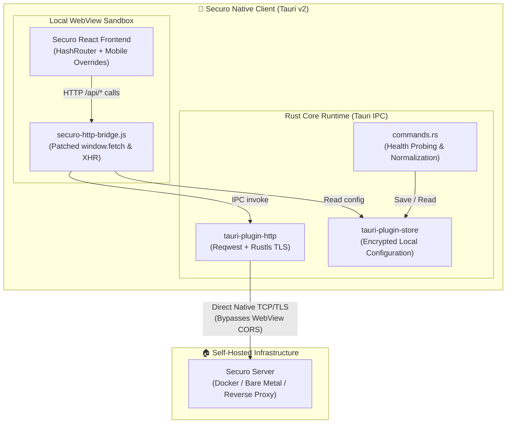

# Securo Native Client

<div align="center">

[](https://github.com/securo-finance/securo-mobile/actions/workflows/ci.yml)
[](https://github.com/securo-finance/securo-mobile/actions/workflows/release.yml)
[](https://tauri.app/)
[](https://www.rust-lang.org/)
[](https://android.com)
[](#license)

**A high-performance, native mobile and desktop client for self-hosted [Securo](https://github.com/securo-finance/securo) personal finance.**

[Overview](#overview) •
[Key Features](#key-features) •
[Architecture](#architecture) •
[Getting Started](#getting-started) •
[Development Workflow](#development-workflow) •
[CI/CD & Releases](#cicd--releases) •
[Troubleshooting](#troubleshooting)

</div>

---

## Overview

**Securo Native Client** (`securo-mobile`) delivers a seamless native experience for connecting to your self-hosted Securo personal finance server.

Running self-hosted applications on mobile browsers or progressive web apps (PWAs) often causes friction:
- **CORS & Mixed-Content Barriers:** Mobile WebViews restrict cross-origin requests, blocking local IP addresses (`192.168.x.x`), custom ports, or VPN domains (WireGuard, Tailscale).
- **Homelab SSL/TLS Rejections:** Private homelabs frequently rely on internal or self-signed TLS certificates, which standard mobile browsers reject outright without recourse.
- **Suboptimal Mobile Ergonomics:** Web browsers consume valuable vertical screen space with URL bars, lack edge-to-edge window inset handling, and do not persist session states reliably in sandboxed contexts.

**Securo Native Client bridges this gap** using **Tauri v2** and **Rust**. The application embeds an optimized build of the official Securo web frontend, while routing all network calls through a custom **native HTTP bridge** powered by Rust's `reqwest` and `rustls`. This architecture delivers native performance, unrestricted network freedom for homelab enthusiasts, and zero third-party cloud intermediaries.

---

## Key Features

- 🔒 **True Self-Hosted Freedom:** Connects directly from your device to your server. No cloud analytics, telemetry, or third-party servers.
- ⚡ **Native HTTP Bridge:** Intercepts both `fetch` and `XMLHttpRequest` at the WebView layer, transparently proxying API traffic through native Rust sockets (`@tauri-apps/plugin-http`). Bypasses browser CORS limitations completely.
- 🛡️ **Homelab & Self-Signed TLS Support:** Optional toggle for self-signed certificates and private domain hostnames, validated securely at the native OS network layer.
- 📱 **Native Android Edge-to-Edge:** Optimized via Android `enableEdgeToEdge()` and CSS safe-area insets, adapting dynamically to device camera notches, status bars, and navigation gesture bars.
- 🔄 **Intelligent Server Discovery:** Validates remote instances across multiple health endpoints (`/api/health`, `/api/info`, `/health`, and root fallback) with detailed diagnostic error logs on connection failures.
- 📦 **Automated Frontend Pipeline:** Built-in toolchain to fetch, adapt (converting to `HashRouter`, patching runtime optional-chaining, applying mobile CSS), and stage the official Securo frontend seamlessly.
- 🚀 **High-Speed Multi-Arch CI/CD:** GitHub Actions workflows featuring `rust-cache` compilation acceleration, building optimized APKs for `arm64-v8a`, `armeabi-v7a`, and `x86_64`.

---

## Architecture



### How the Bridge Works
1. **Frontend Request Interception:** The bundled `securo-http-bridge.js` intercepts any API calls originating from the React frontend (`fetch` or `XMLHttpRequest`).
2. **IPC Native Transport:** Instead of executing in the WebView's restrictive browser network stack, requests are converted into Tauri native HTTP calls.
3. **Rust Dispatch:** Tauri's Rust core performs the HTTP request via `reqwest` with configurable TLS settings (supporting custom homelab certificates).
4. **Transparent Response:** Headers, status codes, and response payloads (JSON, text, or binary blobs) are piped back into the frontend transparently as standard browser response objects.

For a comprehensive technical breakdown, see [ARCHITECTURE.md](ARCHITECTURE.md).

---

## Getting Started

### Pre-built APKs (Recommended)

1. Navigate to the **[Releases](https://github.com/securo-finance/securo-mobile/releases)** page.
2. Download the APK matching your device's CPU architecture:
   - **`arm64-v8a`** (Most modern Android phones and tablets)
   - **`armeabi-v7a`** (Older 32-bit Android devices)
   - **`x86_64`** (Android emulators and select ChromeOS devices)
3. Open the APK on your Android device to install (allow installation from unknown sources if prompted).
4. Launch **Securo**, enter your self-hosted server URL (e.g., `https://securo.home.arpa` or `http://192.168.1.100:8080`), and connect.

---

## Development Workflow

### Prerequisites

Ensure the following dependencies are installed on your host system:

| Dependency | Minimum Version | Description |
| :--- | :--- | :--- |
| **Node.js** | `>= 22.0.0` | JavaScript runtime and build toolchain |
| **npm** | `>= 10.0.0` | Package manager |
| **Rust** | Stable (`>= 1.80`) | Compiles the Tauri native desktop and mobile libraries |
| **Java JDK** | `17` (Temurin recommended) | Required for Gradle Android compilation |
| **Android SDK & NDK** | API 35 / NDK `27.0.12077973` | Required for Android compilation |

For Linux desktop builds, system libraries (`pkg-config`, `libgtk-3-dev`, `libwebkit2gtk-4.1-dev`, `librsvg2-dev`) are also required.

---

### 1. Environment Setup

Clone the repository and install dependencies:

```bash
git clone https://github.com/securo-finance/securo-mobile.git
cd securo-mobile
npm install
```

Install Android compilation targets for Rust:

```bash
rustup target add aarch64-linux-android armv7-linux-androideabi x86_64-linux-android
```

---

### 2. Frontend Ingestion & Staging

Securo Native Client pulls the official Securo web frontend, applies mobile patches, and stages it for Tauri bundling.

```bash
# Step 1: Sparse-clones securo-finance/securo, applies HashRouter & patches, and compiles Vite dist
npm run frontend:prepare

# Step 2: Bundles the HTTP bridge with esbuild, moves assets to src/, and injects mobile overrides
npm run frontend:stage
```

> [!TIP]
> You can point `prepare-frontend` to a custom repository or local fork using environment variables:
> ```bash
> SECURO_REPOSITORY="your-github-user/securo" SECURO_FRONTEND_PATH="frontend" npm run frontend:prepare
> ```

---

### 3. Local Desktop Execution

To run the application locally on your desktop machine (Linux / macOS / Windows):

```bash
npm run tauri -- dev
```

---

### 4. Android Build

Initialize the Android project structure (required once per checkout):

```bash
npm run tauri -- android init
npm run android:configure
```

Compile a debug APK for modern 64-bit ARM devices:

```bash
npm run tauri -- android build --target aarch64 --debug --apk
```

Package and generate SHA-256 checksums:

```bash
npm run artifacts:package
```

The resulting APK will be saved in `artifacts/` (or `src-tauri/gen/android/app/build/outputs/apk/`).

Install directly to a connected Android device or emulator via ADB:

```bash
adb install -r artifacts/securo-v0.1.0-arm64-v8a-debug.apk
```

---

## Configuration & Server Connection

### Initial Setup
Upon first launch, Securo Native Client opens the **Server Configuration** interface:
1. **Server Address:** Input your Securo instance base URL (e.g., `https://finance.myhomelab.net` or `http://10.0.0.15:3000`).
2. **Allow Self-Signed Certificates:** Toggle this switch if your server uses internal self-signed TLS or private authority certificates.
3. **Connect:** The client sends probes to `/api/health`, `/api/info`, `/health`, and `/`.
4. If the probe succeeds, settings are committed to local persistent storage (`config.json`), and the application boots immediately into the Securo dashboard.

### Changing Server URL
To switch to a different instance or reconfigure TLS:
- Click **Change server** in the setup screen or clear the stored connection from the settings menu.
- Alternatively, you can clear app data directly from Android system settings.

---

## CI/CD & Releases

This repository includes two production-grade GitHub Actions workflows:

### 1. Continuous Integration (`.github/workflows/ci.yml`)
- Triggered on every pull request and push to `main`.
- Validates JavaScript syntax across all staging and packaging scripts (`node --check`).
- Verifies that the native HTTP bridge bundles cleanly via `esbuild`.

### 2. Automated Release Pipeline (`.github/workflows/release.yml`)
- Triggered by publishing a git tag (`v*`) or through manual dispatch (`workflow_dispatch`).
- **Matrix Build:** Builds optimized APKs for target architectures (`aarch64`, `armv7`, `x86_64`).
- **Compilation Caching:** Utilizes `rust-cache` (up to 80% build time reduction) and Gradle wrapper caching.
- **Production Keystore Signing:** If repository secrets are configured, APKs are signed for release with `apksigner`.
- **Automatic Debug Fallback:** If secrets are absent, the workflow automatically signs artifacts with the standard Android debug keystore, ensuring pull requests and forks produce immediately testable APKs.
- **Cryptographic Checksums:** Generates a unified `SHA256SUMS.txt` accompanying all published assets.

#### Keystore Configuration (For Maintainers)
To configure production release signing in GitHub Actions, add these repository secrets:

| Secret Name | Description |
| :--- | :--- |
| `ANDROID_KEYSTORE_BASE64` | Base64-encoded content of your `.keystore` or `.jks` file |
| `ANDROID_KEYSTORE_PASSWORD` | Password protecting the keystore file |
| `ANDROID_KEY_ALIAS` | Name of the release key alias |
| `ANDROID_KEY_PASSWORD` | Password for the private key (defaults to keystore password if identical) |

---

## Repository Structure

```text
securo-mobile/
├── .github/
│   └── workflows/
│       ├── ci.yml               # Syntax validation & bridge bundle verification
│       └── release.yml          # Matrix Android build & automated release pipeline
├── scripts/
│   ├── prepare-frontend.mjs     # Clones official web repo, rewrites router, builds dist
│   ├── stage-frontend.mjs       # Bundles HTTP bridge, injects CSS and staging files
│   ├── configure-android.mjs    # Synchronizes Android permissions & MainActivity insets
│   └── package-artifacts.mjs    # Semantic artifact naming & SHA-256 verification
├── src/
│   ├── config/                  # Fallback server connection UI & localization
│   ├── locales/                 # Internationalization strings (en-US, pt-BR)
│   ├── scripts/                 # Setup UI logic and connection validation
│   ├── styles/                  # Setup UI stylesheet
│   ├── bootstrap.html           # Initial routing router between config and dashboard
│   └── app.html                 # Container hosting the staged Securo React dashboard
├── src-tauri/
│   ├── bridge/
│   │   ├── http-bridge.js       # Monkey-patches window.fetch and XHR to Rust
│   │   ├── MainActivity.kt      # Android edge-to-edge window insets handler
│   │   └── mobile-overrides.css # Mobile layout, safe-area, and touch-target styles
│   ├── capabilities/            # Tauri v2 security policies & network permissions
│   ├── src/
│   │   ├── commands.rs          # Server probing, URL normalization, store handlers
│   │   ├── errors.rs            # Structured application error reporting
│   │   ├── state.rs             # Thread-safe global Tauri state mutex
│   │   └── lib.rs               # Tauri application builder & entry point
│   ├── Cargo.toml               # Rust dependency manifest & optimization profiles
│   └── tauri.conf.json          # Tauri application and window configuration
└── package.json                 # Project scripts and npm dependencies
```

---

## Troubleshooting

<details>
<summary><b>1. Connection failed: "SERVER_UNREACHABLE"</b></summary>

- Verify that your Securo server is running and accessible from the mobile device's network (e.g. ensure you are on the same Wi-Fi network or connected via VPN).
- If your server uses a self-signed SSL/TLS certificate, make sure to enable the **"Allow self-signed certificate"** option in the connection settings.
- If using an IP address, ensure you specify the protocol and port (e.g., `http://192.168.1.50:8080`).
- Tap **Copy** in the error diagnostic panel to inspect detailed probe output from `/api/health`, `/api/info`, and `/health`.
</details>

<details>
<summary><b>2. White screen or blank screen on Android</b></summary>

- Run `npm run frontend:prepare` followed by `npm run frontend:stage` to ensure that client routing is properly configured for `HashRouter`. Browser history routing (`BrowserRouter`) cannot resolve local relative bundle paths inside mobile WebViews.
- Ensure `npx esbuild` bundled `securo-http-bridge.js` into `src/`.
</details>

<details>
<summary><b>3. Missing Android SDK / NDK during build</b></summary>

- Ensure `ANDROID_HOME` and `NDK_HOME` environment variables are properly defined:
  ```bash
  export ANDROID_HOME=$HOME/Android/Sdk
  export NDK_HOME=$ANDROID_HOME/ndk/27.0.12077973
  export PATH=$PATH:$ANDROID_HOME/platform-tools:$ANDROID_HOME/cmdline-tools/latest/bin
  ```
</details>

---

## Contributing

Contributions from the community are warmly welcome! Whether you are fixing bugs, improving the mobile UX, optimizing build pipelines, or adding translations, your help makes Securo better for everyone.

Please review [CONTRIBUTING.md](CONTRIBUTING.md) for details on code style, branch conventions, and testing guidelines.

---

## Security & Privacy

- **Zero Data Collection:** Securo Native Client collects, stores, and transmits zero user telemetry or tracking data.
- **Direct Communication:** All network communication is strictly peer-to-peer between your mobile device and your configured server endpoint.
- **Local Credentials:** Configuration data is stored locally on the device using Tauri's sandboxed store implementation.

---

## License

This project is licensed under the terms of either the [MIT License](LICENSE-MIT) or the [Apache License, Version 2.0](LICENSE-APACHE), at your option.
